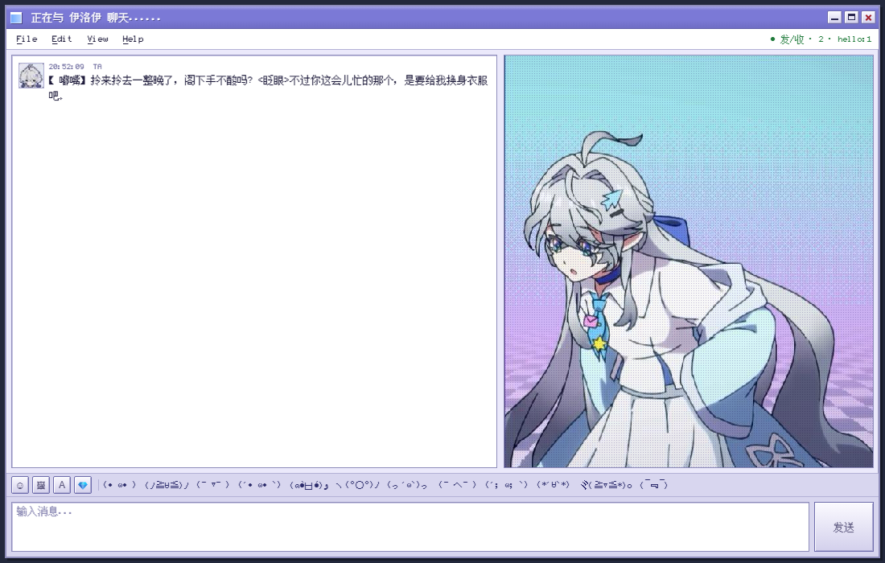

# 和Y？聊天（曳尔沐对话）

`elymes-nte-web` 0.2.2 —— 把聊天做成 QQ2007 / Windows 98 那种老窗口和千禧风 CRT 窗口：独立开无地址栏窗口，右侧像素立绘跟着对话关键词换表情，另带一只会躲光标的透明桌宠。

> 原名「千禧年外壳」（`cortico-world-millennium`）。这一版是去过宿主耦合、可以单独分发的形态。
> 中文名里的 Y 指原著里的曳尔沐；改成「和Y？聊天」是为了更贴合原著。



更多实拍图在 [assets/screenshots/](assets/screenshots/)：旧聊天窗、千禧风窗口、桌宠与 2D 界面同时出现的样子。

## 彩蛋（不剧透）

包里藏着一个**和数字、正文原文有关**的小彩蛋：某些输入会把聊天窗整块换掉。触发条件写在正文里，不是菜单里的按钮，也不靠奇怪的快捷键。

想自己找的话，先随便聊几句，再注意窗口里出现的数字和句子。

还找不到的话，线索在《异环》官方的特别剧情短片 [BV1PWxT6cE4E](https://www.bilibili.com/video/BV1PWxT6cE4E) 和 1.5 主线剧情里。

## 0.2.2 更新

- 市场标签与图标补回（`cortico.tags` / `icon` / `screenshots`），平台标记「仅 Windows」。
- 桌宠左键改为冒像素气泡（白底黑边、像素字体，4 秒消失）；双击受击同时冒一句；台词可在 Edit →「气泡台词」里增删。
- 右键菜单拆成三个入口：QQ2007 聊天窗、千禧风窗口、2D 界面。
- 安装包补上 `ws` 依赖声明与 `tools/win-frame.ps1`、`tools/nt-top.ps1`，装完不再是无边框退化的样子。

## 它做了什么

- **独立窗口**：不往宿主页面上盖皮肤，而是拉起本地服务，再用 Edge / Chrome 的 `--app` 模式开窗口，DOM 完全自己写。
- **三种聊天窗口**：QQ2007 风格主窗（File/Edit/View/Help 四面板）、千禧风 CRT 窗（1000×760 设计稿，可自由缩放，缩放时整张等比缩放）、2D 聊天界面（像素立绘 + 气泡）。
- **操作技巧页**：Help 里新增「操作技巧」，把三种窗口的开关限制、聊天键位、桌宠交互、窗口缩放、快捷键、常见问题都写在一页里。
- **像素立绘**：13 张立绘分成 5 组动作（说话 / 介绍 / 大笑 / 生气 / 张望），按回复里的关键词自动切换，带 CRT 扫描线和轻微抖动。
- **透明桌宠**：32 张动画素材，会自己逛、会躲光标、双击受击闪白；单击冒一句像素气泡（4 秒消失，再点换一句），右键菜单里有 QQ2007、千禧风、2D 三个入口。
- **本地反代**：Core 的 WebSocket 握手会拒绝跨站 Origin，而浏览器发的 WS 一定带 Origin；本地服务在 Node 侧转发不带 Origin，握手才能过。

> 没有全局键盘监听。这个版本里桌宠不读 W/A/S/D，任何输入都由页面自己处理。

## 安装

这是个 **Coopanion world 插件**，需要宿主才能跑（它自己不是独立应用）。

### 放进宿主

1. 把整个目录放到 `<Coopanion>/data/extensions/elymes-nte-web/`
2. 在 `<Coopanion>/data/extensions/package.json` 的 `dependencies` 里加一行：

   ```json
   "elymes-nte-web": "file:./elymes-nte-web"
   ```

3. 在 `data/extensions/` 下执行 `npm install`（或手工把目录链接到 `node_modules/elymes-nte-web`）
4. 重启 Coopanion，在「世界与插件」里启用 **在网页上与曳尔沐聊天**

### 从 npm 装

```bash
npm i elymes-nte-web
```

装好后 Coopanion 会按 `keywords` 里的 `cortico-world` 认出来，重启后在「世界与插件」里启用 **和Y？聊天**。

依赖只有 `ws`（本地反代用），`npm i` 会自动装。

## 怎么用

启用后，插件面板（「世界与插件」→ 在网页上与曳尔沐聊天）里有这些操作：

| 操作 | 作用 |
|---|---|
| 打开聊天窗口 | 起本地服务 + 开独立窗口 |
| 打开桌宠 | 优先塞进宿主的透明浮层，拿不到就退回 Edge 小窗 |
| 关闭窗口 / 关闭桌宠 | 收掉对应进程 |
| 导入立绘 | 选本地图片按动作分组写入 `assets/portrait/`，重开窗口生效 |

桌宠的交互：单击唤起聊天窗口、双击受击、右键菜单（打开聊天 / 别躲我 / 随便逛逛 / 藏起来）。

**注意：桌宠和 2D 聊天界面只能同时开一个**，它们都走透明浮层；旧聊天窗和千禧风窗口共用同一个浏览器资料目录，也只能开一个。

### 窗口里的菜单

窗口顶部有一排菜单，点开就是不同的面板：

| 菜单 | 面板内容 |
|---|---|
| File | 对话（默认页） |
| Edit | 设置：立绘尺寸 60/75/90/120 px、桌宠避让 90/130/200、移动速度 0.6/1/1.6、是否原地休息，改完按「保存」 |
| View | 已装插件列表（从扩展目录读名字和版本） |
| Help | 六个页签：接入（Core 地址、端口、连接状态）、人格记忆（读改 `CONSTITUTION.md`）、诊断（core.log 尾部 + 端口 + Node 版本）、千禧风窗口、2D 聊天界面、操作技巧 |

Edit 里的设置存成文件，桌宠那边会立刻收到，不用重启。

## 配置

配置分两处，互不干扰。

### 一、窗口设置（存在扩展目录里）

窗口 Edit 面板和桌宠共用一份 `state/pet-config.json`，由本地服务读写。删掉这个文件就恢复默认。

| 键 | 默认 | 说明 |
|---|---|---|
| `size` | `60` | 桌宠尺寸，24–200 px |
| `avoidIn` | `130` | 光标进到多少 px 以内开始躲 |
| `avoidOut` | `200` | 躲到多远算安全 |
| `speed` | `1` | 移动速度倍率，0.3–3 |
| `follow` | `false` | 跟随光标 |
| `followRadius` | `100` | 跟随停下的距离 |
| `rest` | `true` | 逛累了会不会原地休息 |
| `restMsMin` / `restMsMax` | `3500` / `7000` | 每次休息时长区间（毫秒） |
| `restGapMin` / `restGapMax` | `6000` / `14000` | 两次休息的间隔区间（毫秒） |

写坏或手改超界的值会被夹回合理区间，不会让窗口报错。

### 二、宿主的皮肤面板（存在浏览器里）

`tools/webui.source.js` 那套复古皮肤设置存在 localStorage 的 `elymes-nte-web.skin.v1` 下：

| 键 | 默认 | 说明 |
|---|---|---|
| `enabled` | `true` | 是否启用复古皮肤 |
| `glitch` | `true` | 立绘切换时的抖动/故障效果 |
| `closeSendsX` | `true` | 关窗口时是否往输入框塞一个 X |
| `portraitWidth` | `320` | 立绘宽度（180–560） |
| `idleFace` | `'talk'` | 空闲时用哪组动作 |
| `faces` | 5 组内置 | 每组的帧、帧间隔、触发关键词 |
| `kaomoji` | 12 个 | 底部颜文字快捷键 |

### 环境变量（可选）

| 变量 | 说明 |
|---|---|
| `ENW_PORT` | 本地服务端口，默认 `18800` |
| `ENW_CORE` | 上游 Core 地址，默认 `http://127.0.0.1:17788` |
| `ENW_PET_HOST` | 手动指定透明桌宠的宿主命令（JSON 数组） |
| `ENW_HOME` | 宿主 home 目录，用来找人性和日志（见下节） |
| `CORTICO_HOME` | 同上，宿主自己会设；没设 `ENW_HOME` 时读这个 |
| `CORTICO_EXTENSIONS_DIR` | 扩展目录，View 面板列插件用 |

## 和宿主深集成的那三样（可选）

Help 面板里的「人格记忆」和「诊断」、View 面板里的「插件列表」，读的是宿主自己的文件：

| 能力 | 读的路径 | 从哪来 |
|---|---|---|
| 人格记忆 | `<home>/companion/workspace/CONSTITUTION.md` | `ENW_HOME` → `CORTICO_HOME` → 往上推两级猜 |
| 记忆条目 | `<home>/companion/workspace/notes/` | 同上 |
| 诊断日志 | `<home>/../logs/core.log` | 同上 |
| 插件列表 | `CORTICO_EXTENSIONS_DIR` → 包目录上一级 | 环境变量优先 |

**这三样都不是必需品。** 拿不到路径时，对应面板显示「未配置」并说明原因，聊天、桌宠、立绘全部照常。装在非 Coopanion 环境里唯一要做的就是把 `ENW_HOME` 指到别处，或者干脆不管。

## 目录结构

```
src/index.mjs            插件入口（world 定义：面板、窗口、桌宠、立绘导入）
tools/window-server.mjs  本地服务：静态页 + 反代上游 WS + 窗口面板接口
tools/window/            独立窗口的页面（index.html / window.js / pet.html / crt.* / ui2.*）
tools/win-frame.ps1      Windows 无边框外挂（旧聊天窗与千禧风窗口用）
tools/nt-top.ps1         「10KB」置顶小彩蛋
tools/webui.source.js    宿主 WebUI 面板源码
tools/build.mjs          把面板源码 + 内联 base64 素材打成 dist/webui.js
dist/webui.js            面板产物（构建出来的，别手改）
dist/webui.css           面板样式
assets/portrait/         立绘 13 张
assets/pet/              桌宠动画 32 张
assets/fonts/            破晓像素字体
assets/screenshots/      四张实拍说明图
开发中遇到的问题.md        开发过程里踩过的坑与处理方式
state/pet-config.json    窗口设置（运行时生成，不进包）
```

## 开发

```bash
# 改完 tools/webui.source.js 或换了素材后重新构建
node tools/build.mjs

# 单独把本地服务跑起来调试（不带宿主）
node tools/window-server.mjs
# 然后浏览器打开 http://127.0.0.1:18800/
```

开发中踩过的坑（端口占用、升级丢补丁、窗口缩放、热区错位、网页端缓存等）整理在 [开发中遇到的问题.md](开发中遇到的问题.md)。

## 素材来源

立绘、桌宠素材和字体都不是本仓库原创，来源与授权见 [assets/SOURCES.md](assets/SOURCES.md)。**商用前请先确认原权利人授权。**

## 许可

代码以 MIT 许可发布，见 [LICENSE](LICENSE)。素材部分另有约束，见上。
